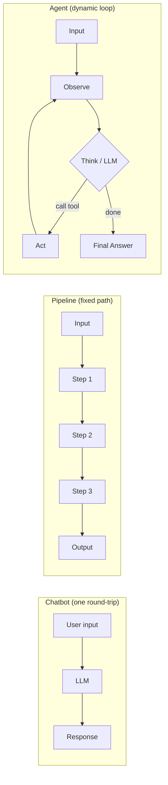
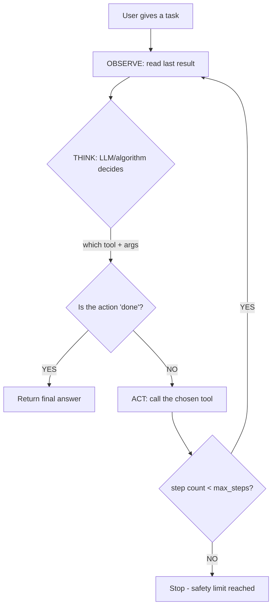

# Lesson 1: Foundations — What Is an Agent?

## Overview

This lesson defines what an AI agent is, how it differs from chatbots and pipelines, and introduces the core pattern every agent shares: the **Observe → Think → Act** loop. By the end, you'll understand the skeleton that all agents — from simple bots to complex multi-step systems — are built on, and you'll have run two working examples: one with a plain algorithm as the "brain" and one powered by an LLM.

## Key Concepts

1. **Agent** — A program that uses an LLM to *decide* what actions to take in a loop, observing results and adjusting until a task is complete.
   - *Analogy:* A `while` loop where the loop body is an LLM call, and the LLM's output determines both the action and whether to continue or break.
   - *Why it matters:* Without this loop, you just have a one-shot chatbot. The loop is what lets an agent handle tasks that require multiple steps, like parsing a resume *then* searching for jobs *then* ranking results.

2. **Tool** — A function the agent can call to interact with the world (search the web, read a file, call an API).
   - *Analogy:* Like dependency injection — you give the agent a set of capabilities, and it picks which ones to use at runtime.
   - *Why it matters:* An LLM can only generate text. Tools give it hands — the ability to *do things* beyond talking.

3. **Observe → Think → Act Loop** — The repeating cycle that drives every agent:
   - **Observe:** Read the result of the last action (or the user's initial input).
   - **Think:** The LLM (or algorithm) decides what to do next.
   - **Act:** Execute the chosen tool and get back a result.
   - *Analogy:* Like a REPL (Read-Eval-Print Loop), but the "Eval" step is an LLM choosing from a menu of tools.
   - *Why it matters:* This is the fundamental pattern. Every agent framework (LangChain, CrewAI, AutoGen) implements this loop internally. Understanding it means you can build agents *without* a framework, and debug them *within* one.

The difference between these three is easier to see visually:



4. **Action as Data** — The agent's decision is represented as a structured dict (`{'tool': 'name', 'args': {...}}`), not a direct function call.
   - *Analogy:* Like the Command pattern in OOP — actions are objects that can be inspected, logged, validated, and then executed.
   - *Why it matters:* When the brain is an LLM, it returns text. We parse that text into a structured action dict. Keeping actions as data lets us validate them before execution (did the LLM pick a real tool? Are the arguments valid?).

5. **Max Steps (Safety Limit)** — A hard cap on how many iterations the loop can run.
   - *Analogy:* Like a circuit breaker in a distributed system — it prevents runaway behavior.
   - *Why it matters:* LLMs can hallucinate or get stuck. Without a max, a confused agent loops forever, burning API credits and producing nothing.

## How It Works (Step by Step)



## Code Walkthrough

### File: `01_simple_loop_agent.py`

**Purpose:** Demonstrates the agent loop pattern with NO LLM. A number-guessing agent uses binary search as its "brain" to find a secret number between 1-100.

**Key parts explained:**

| Section | What It Does | Why It's Written This Way |
|---------|-------------|--------------------------|
| `guess_checker()` | A **tool** — takes a guess, returns "too high"/"too low"/"correct" | Tools return strings (observations), not booleans. This mirrors how real agent tools work — the LLM reads text. |
| `think()` | The **brain** — reads the observation, updates state, picks the next action | Returns a dict `{'tool': ..., 'args': ...}`, not a function call. Actions as data = inspectable, loggable, validatable. |
| `state` dict | Tracks `low`, `high`, `last_guess` across iterations | Agents need memory between steps. Without state, each step is blind to what happened before. |
| `run_agent()` while loop | The **agent loop** — observe → think → act → repeat | The loop dispatches actions by reading the dict's `'tool'` key. This is the same dispatch pattern LLM agents use. |
| `max_steps = 20` | **Safety limit** | Prevents infinite loops. In real agents, this prevents runaway LLM calls that burn money. |
| `action["tool"] == "done"` | **Stop condition** | The brain decides when the task is complete — not the loop. This is what makes agents dynamic vs. fixed pipelines. |

**Run it:**
```bash
python3 01-foundations/01_simple_loop_agent.py
```

**Expected output:** The agent guesses the secret number in ~7 steps using binary search, printing each step's observation and action.

**How the code maps to the agent loop:**

```mermaid
sequenceDiagram
    participant User
    participant Loop as Agent Loop (run_agent)
    participant Brain as Think (binary search)
    participant Tool as guess_checker

    User->>Loop: secret = 38
    Loop->>Brain: observation="start", state={low:1, high:100}
    Brain-->>Loop: action={tool: guess_checker, guess: 50}
    Loop->>Tool: guess=50, secret=38
    Tool-->>Loop: "too high"
    Loop->>Brain: observation="too high", state={low:1, high:49}
    Brain-->>Loop: action={tool: guess_checker, guess: 25}
    Loop->>Tool: guess=25, secret=38
    Tool-->>Loop: "too low"
    Loop->>Brain: observation="too low", state={low:26, high:49}
    Brain-->>Loop: action={tool: guess_checker, guess: 37}
    Note over Loop: ...continues until...
    Loop->>Brain: observation="correct"
    Brain-->>Loop: action={tool: done, answer: 38}
    Loop->>User: Answer: 38
```

## Trade-Offs & Alternatives

| Decision We Made | Alternative | Why We Chose This | What We Give Up |
|---|---|---|---|
| Actions as dicts | Direct function calls in `think()` | Decouples decision from execution; mirrors how LLMs work (they return text, not code) | Slightly more code for the dispatch logic |
| String observations | Structured return types (bool, int) | LLMs read text — training with strings from day 1 builds the right habit | Lose type safety on observations (we'll fix this with Pydantic in Lesson 2) |
| Single `think()` function | Separate "plan" and "decide" steps | Keeps the skeleton simple for Lesson 1 | Real agents benefit from planning — covered in Lesson 4 |
| Hardcoded tool dispatch (`if action["tool"] == ...`) | Tool registry (dict of callables) | Readable for a first example | Doesn't scale — we'll build a registry in Lesson 2 |

## Common Pitfalls

- **Forgetting the safety limit.** Every agent loop MUST have a `max_steps` or equivalent. It's not optional — it's a production requirement.
- **Returning raw function results instead of string observations.** When you add an LLM brain, it reads text. Get in the habit of returning human-readable strings from tools now.
- **Hardcoding the loop path.** If you find yourself writing `if step == 1: do this, elif step == 2: do that`, you're building a pipeline, not an agent. The whole point is that the brain decides the path dynamically.
- **Confusing state with observations.** State is *internal memory* that persists across steps. Observations are *external feedback* from the last action. Both feed into `think()`, but they're different things.

## Quick Reference

- **Agent = LLM + Tools + Loop**
- **Loop pattern:** `while step < max_steps: action = think(observation, state) → execute action → get new observation`
- **Actions are data:** `{'tool': 'tool_name', 'args': {'key': 'value'}}`
- **Stop condition:** The brain returns a special "done" action — the loop doesn't decide when to stop.
- **Always set `max_steps`** — no exceptions.
- **Tools return strings** — readable observations the LLM can interpret.

## What's Next

This lesson used a binary search algorithm as the brain. In **Lesson 2: Tool Use**, we'll replace that brain with an actual LLM (Google Gemini), learn how LLMs express tool calls using function-calling APIs, and build a proper tool registry so we don't hardcode tool dispatch.
