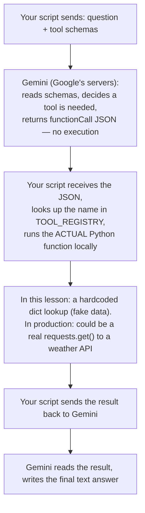
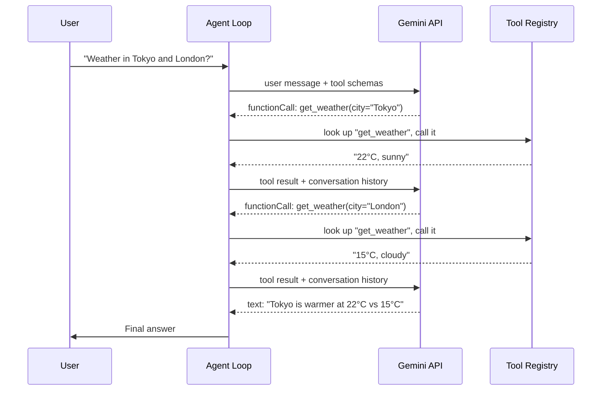
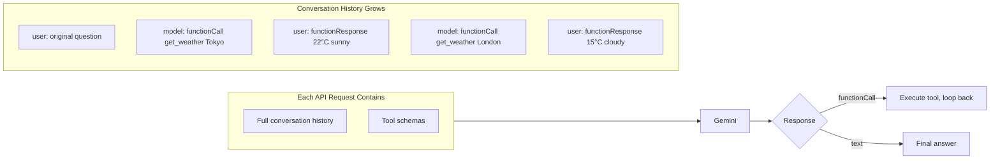

# Lesson 2: Tool Use — Giving the Agent Hands

## Overview

This lesson teaches how LLMs interact with external tools (functions). You'll learn that LLMs cannot actually call functions — they produce structured text requesting a call, and our code executes it. We cover tool schemas (how you describe tools to the LLM), the tool registry pattern (how you dispatch calls), and the full round-trip: user question → LLM requests a tool call → our code executes the tool → result sent back to the LLM → LLM forms a final answer. We build this against Google Gemini (a cloud flagship model) and hit a real free-tier rate limit mid-lesson, which we work around with a local response cache and by switching to a model variant with its own separate quota bucket.

## Key Concepts

1. **Tool Schema (Function Declaration)** — A JSON description of a tool: its name, what it does, and what arguments it takes. This is what the LLM reads to decide whether and how to use a tool.
   - *Analogy:* Like an API spec (OpenAPI/Swagger) — the consumer (LLM) reads the spec, never the implementation.
   - *Why it matters:* The LLM never sees your Python code. If your schema description is vague, the LLM will misuse the tool. Good descriptions = good tool selection.

2. **Function Calling** — The mechanism where an LLM returns a structured `functionCall` object instead of text, saying "call this tool with these arguments."
   - *Analogy:* Like a manager writing a work order instead of doing the task — they specify what to do, someone else executes it.
   - *Why it matters:* This is the bridge between "thinking" (LLM) and "doing" (tools). Without it, agents could only talk, not act.
   - *Not every model has this:* It requires the provider to specifically fine-tune the model to recognize a `tools`/`functions` field and reliably emit structured JSON instead of prose. Also called "tool use" (Anthropic) or "tool calling" (generic term). Models with native support: Gemini 1.5+, GPT-4/4o+, Claude 3+, Llama 3.1+ (available via Groq), Mistral Large, Cohere Command R+. A model without this fine-tuning can only *simulate* it through prompting — describing the expected JSON format in plain text and parsing the output yourself — which is far less reliable and is the historical basis of the ReAct pattern (Lesson 4).

3. **Tool Registry** — A dictionary mapping tool names (strings) to actual Python callables. When the LLM says "call get_weather", we look it up here.
   - *Analogy:* Like a service locator or dependency injection container — decouple the name from the implementation.
   - *Why it matters:* Hardcoding `if name == "get_weather"` doesn't scale. A registry lets you add tools without changing dispatch logic.

4. **Round-Trip Protocol** — The full cycle: send message + tools → receive function call → execute → send result back → receive final answer.
   - *Analogy:* Like a request-response cycle in HTTP, but between your code and the LLM, with tool execution in the middle.
   - *Why it matters:* Each round-trip is an API call that costs tokens and time. Understanding this helps you design agents that minimize unnecessary round-trips.

5. **Thought Signature** — A cryptographic token Gemini attaches to each function call. Must be echoed back when sending the tool result.
   - *Analogy:* Like a CSRF token in web forms — proves the action originated from a legitimate source (the model's reasoning).
   - *Why it matters:* If you reconstruct the function call response instead of echoing the raw part, the API rejects it. Always preserve the model's original response.

6. **Tool Selection Is Not RAG** — The LLM decides which tool to call using in-context reasoning over the schemas sent in *every* request, not retrieval from a vector database.
   - *Analogy:* RAG is "look up a relevant document and read it before answering." Function calling is "read today's menu (sent fresh every time) and decide whether to order."
   - *Why it matters:* There's no persistent memory of your tools, no embeddings, no search index for a handful of tools — the full schema list travels in the request body every single call. The LLM was *trained* to recognize this format and reason about when a described function would help answer the question, which is why it generalizes to brand-new tools it's never seen. (At scale — hundreds of tools — teams do use embeddings to retrieve only the *relevant* tool schemas before calling the LLM; that specific technique genuinely is RAG, just applied to tool selection instead of document knowledge. We don't need it yet.)

7. **Parallel Function Calling** — A single Gemini response can contain multiple `functionCall` parts at once, when the model determines the calls are independent (none needs another's result first).
   - *Analogy:* Like a manager handing out three independent work orders in one meeting, instead of waiting for each one to finish before assigning the next.
   - *Why it matters:* Fewer round trips to the LLM = fewer API calls against your free-tier rate limit, less re-sent conversation history, lower latency. Code that only reads the *first* tool call per response (a mistake we made in Example 3 — see the callout below) silently drops the rest, breaking multi-tool tasks. Whether the model actually batches calls is its own judgment based on whether the sub-tasks are independent — your code just needs to be *capable* of handling 1-or-more calls per response.

8. **Free-Tier Rate Limits Are Per-Model, Per-Day** — Google's free tier caps each specific model name at a fixed number of requests per day (we observed **20/day** for `gemini-3.5-flash`), tracked separately per model and per project.
   - *Analogy:* Like separate API keys with separate quotas for each microservice — exhausting one doesn't touch the others.
   - *Why it matters:* We hit this limit live, mid-lesson, after repeated debug runs. A `-lite` variant of the same model (e.g. `gemini-3.5-flash-lite`) has its *own* separate 20/day bucket, so switching model names is a valid same-day escape hatch. The 429 error's `retryDelay` field tells you exactly how long until reset. This is why a local response cache (see `gemini_cache.py` below) matters during development — every rerun of a script while debugging spends real quota, even for a request you've made before. (This project later moved to Groq as the primary provider specifically because its free tier is dramatically larger — see `CLAUDE.md`.)

## FAQ: Where Does the Tool's Data Actually Come From?

A common point of confusion: when Gemini returns a `functionCall`, does Gemini "run" anything? **No.** Gemini only ever produces and consumes text/JSON over HTTP — it never executes code and never touches your machine. All execution happens in *your* local Python process:



In `03_agent_with_tools.py`, `get_weather()` is a **fake** function — a Python dict of hardcoded strings, not a live API call. Gemini has no idea whether the implementation behind a tool name is real or fake, local or remote, a database query or a dictionary lookup. It only ever sees the *description* and the *result string* that comes back. That separation — the LLM reasons about *when* to act, your code owns *how* the action happens — is the entire point of the tool-use pattern.

## How It Works (Step by Step)



The critical thing: **Gemini decided to call the tool twice** (once per city), then stopped and answered. We didn't hardcode that — the LLM read the tool descriptions and made its own plan.

### What gets sent to Gemini on each API call



## Code Walkthrough

### File: `01_tool_schema.py`

**Purpose:** Shows the data structures *before* any API call. No network, no API key needed.

| Section | What It Does | Why |
|---------|-------------|-----|
| `get_weather()`, `calculate()` | Real Python functions (tools) | These are what the agent actually executes — the LLM never sees this code |
| `tool_schemas` list | JSON Schema descriptions of each tool | This is what the LLM reads to decide which tool to call and how |
| `tool_registry` dict | Maps `"get_weather"` → `get_weather` function | Decouples tool name (string from LLM) from tool implementation |
| `simulated_llm_response` | Fake Gemini response with a `functionCall` | Shows the exact shape of what Gemini returns before we go live |
| `extract_tool_call()` | Parses response → `{'name': ..., 'args': ...}` | Separates parsing from execution — single responsibility |
| `execute_tool()` | Looks up registry + calls function with `**args` | `**args` unpacks the dict into keyword arguments |

**Run it:**
```bash
python3 02-tool-use/01_tool_schema.py
```

### File: `02_raw_gemini_call.py`

**Purpose:** Makes ONE real API call to Gemini with tool declarations. Shows the raw HTTP request and response — no SDK, no abstraction.

| Section | What It Does | Why |
|---------|-------------|-----|
| `URL` construction | `v1beta/models/gemini-3.5-flash-lite:generateContent?key=...` | This is the REST endpoint — understanding the URL structure matters for debugging |
| `tools` list wrapping | Schemas wrapped in `{"function_declarations": [...]}` | Gemini expects this specific nesting — a common source of "schema not recognized" bugs |
| `request_body` | `{"contents": [...], "tools": [...]}` | Two things go in: the conversation and the tool menu |
| `requests.post()` | Raw HTTP POST with JSON body | No SDK — you see exactly what goes over the wire |
| Response parsing | Extract `functionCall` from `parts` | Gemini puts function calls in `candidates[0].content.parts` |

**Run it:**
```bash
python3 02-tool-use/02_raw_gemini_call.py
```

### File: `03_agent_with_tools.py`

**Purpose:** The complete agent loop — Gemini decides which tools to call, our code executes them, results go back, loop continues until a text answer.

| Section | What It Does | Why |
|---------|-------------|-----|
| `call_gemini()` | Wraps the HTTP call, handles errors | Keeps the loop clean — one function for the API call |
| `parse_response()` | Returns `(text, None)` or `("", tool_call)` | The loop only needs to ask: "is this text or a tool call?" |
| `tool_call["raw_part"]` | Preserves the original response part | Must echo back `thoughtSignature` — reconstructing the part breaks the API |
| `messages` list | Grows with each step: user msg, model calls, tool results | This IS the agent's memory — Gemini re-reads the full history on every call |
| `functionResponse` message | How we send tool results back to Gemini | Format: `{"functionResponse": {"name": ..., "response": {"result": ...}}}` |
| Two-query main block | Tests weather comparison + math | Shows the agent handles different tool-selection patterns |

**Run it:**
```bash
python3 02-tool-use/03_agent_with_tools.py
```

**Expected output:** For the weather query, the agent makes 3 steps (two tool calls + final answer). For the math query, 2 steps (one tool call + final answer).

> **Known limitation of this file:** `parse_response()` here returns on the *first* `functionCall` part it finds in a response and ignores any others. If Gemini ever batches multiple tool calls into one response (see "Parallel Function Calling" below and `04_parallel_tool_calls.py`), this version silently drops everything after the first. Kept as-is intentionally — it's the simplest version to learn the loop from — but don't copy this pattern into real code.

### File: `04_parallel_tool_calls.py`

**Purpose:** Fixes the limitation above. Collects **all** `functionCall` parts from a single response, executes every one, and batches all results into one round trip back to Gemini — instead of one API call per tool.

| Section | What It Does | Why |
|---------|-------------|-----|
| `parse_response()` returns a **list** | Collects every `functionCall` part found, not just the first | A single Gemini response can legitimately contain 2+ tool calls — losing any of them breaks the agent's reasoning |
| `model_parts` / `response_parts` lists | Accumulate one entry per tool call *before* appending to `messages` | Gemini expects all calls from one turn echoed together in a single `model` message, and all results together in a single `user` message — not split across multiple round trips |
| Query: 3 independent cities | Deliberately asks for 3 unrelated lookups | Independent sub-tasks (no city's weather depends on another's) are exactly what triggers the model to batch calls together |

**Run it:**
```bash
python3 02-tool-use/04_parallel_tool_calls.py
```

**Expected output:** Step 1 shows `Gemini requested 3 tool call(s) in this response` — all three `get_weather` calls arrive together, executed in a single step, costing only 2 total API calls instead of 4 (3 tool calls + 1 final answer, sequential) or 3 (if only 2 cities as in Example 3).

### File: `gemini_cache.py`

**Purpose:** A local disk cache so identical requests during development cost zero quota on repeat runs. Built after hitting a real 429 (quota exhausted) while debugging — see "Free-Tier Rate Limits Are Per-Model, Per-Day" above.

| Section | What It Does | Why |
|---------|-------------|-----|
| `_cache_key()` | Hashes the request body with `sha256`, using `sort_keys=True` in `json.dumps` | A dict's key order can vary between equivalent calls; sorting guarantees identical requests always hash identically |
| `get_cached()` | Looks for `.gemini_cache/<hash>.json` before any API call | Called at the *top* of `call_gemini()` — if found, we skip the network entirely |
| `save_to_cache()` | Writes the response to disk after a real API call succeeds | Only successful responses get cached — errors are never cached, so a transient failure doesn't poison future runs |
| `.gemini_cache/` directory | Gitignored | Cached responses are local dev scratch, not something to commit or share |

**How it's wired into `04_parallel_tool_calls.py`:** `call_gemini()` checks `get_cached(body)` first; on a miss, it calls the real API and then `save_to_cache(body, result)`. The rest of the agent loop is unchanged — caching is invisible to `run_agent()`.

**Run it (demonstrates the cache hit):**
```bash
rm -rf 02-tool-use/.gemini_cache   # start clean
python3 02-tool-use/04_parallel_tool_calls.py   # 1st run: real API calls
python3 02-tool-use/04_parallel_tool_calls.py   # 2nd run: "(served from cache, no API call made)"
```

## Trade-Offs & Alternatives

| Decision We Made | Alternative | Why We Chose This | What We Give Up |
|---|---|---|---|
| Raw HTTP with `requests` | Google's `google-genai` SDK | See exactly what goes over the wire — no hidden magic | More boilerplate; SDK handles retries, streaming, auth |
| Tool schemas as dicts | Auto-generate from Python type hints | Explicit schemas force you to think about what the LLM sees | Repetitive — you write the schema AND the function |
| Echo raw response parts | Reconstruct the function call dict | Required by Gemini (thoughtSignature) and future-proof | Carries opaque fields we don't control |
| Fake tool data (weather) | Real weather API | Keeps focus on the agent pattern, not external API integration | Can't demo with real data yet (covered in later lessons) |
| `gemini-3.5-flash-lite` model | `gemini-3.8-flash` (latest, higher quality) | We hit the 20-req/day quota on the non-lite model mid-lesson; switched to a model with its own separate quota bucket | Lite models trade some response quality for availability |
| Collect ALL tool calls per response (Ex. 4) | Handle only the first (Ex. 3) | Fewer round trips = fewer API calls against rate limits | Slightly more bookkeeping — must batch results into one message, not one-per-call |

## Common Pitfalls

- **Vague tool descriptions.** If your description says "does stuff with data", the LLM won't know when to use it. Be specific: *what* the tool does, *when* to use it, *what* it returns.
- **Reconstructing function call parts** instead of echoing the raw response. Gemini requires `thoughtSignature` — always pass back the original `part` dict.
- **Forgetting to send the full conversation history.** Gemini is stateless — every API call must include ALL prior messages. If you only send the latest, it loses context.
- **Not handling the "no tool match" case.** The LLM might call a tool name that doesn't exist in your registry (hallucination). Always check `if name in registry` before calling.
- **Putting secrets in tool schemas.** The schema is sent to the LLM on every call. Don't include API keys, internal URLs, or sensitive data in descriptions.
- **Reading only the first `functionCall` in a response.** A response can contain several. Loop over *all* parts and collect every tool call before executing — otherwise you silently drop valid requests and the agent's results will be incomplete.

## Quick Reference

- **Tool Schema Format:**
  ```json
  {"name": "tool_name", "description": "when/what", "parameters": {"type": "object", "properties": {...}, "required": [...]}}
  ```
- **Wrap schemas for Gemini:** `[{"function_declarations": [schema1, schema2]}]`
- **Response has a tool call when:** `"functionCall" in part`
- **Send results back as:** `{"role": "user", "parts": [{"functionResponse": {"name": "...", "response": {"result": "..."}}}]}`
- **Always echo the raw model part** — don't reconstruct it (thoughtSignature).
- **The conversation history IS the agent's memory** — it grows with each step.
- **Collect ALL `functionCall` parts per response**, not just the first — Gemini may batch independent calls (parallel function calling).
- **Batch results from one step into one `model` message + one `user` message**, even when that step had multiple tool calls.

## What's Next

We now have an agent that can use tools across multiple steps against a cloud flagship model, with a documented, verified rate-limit ceiling and a caching strategy to work around it during development. In **Lesson 3: Multi-Step Reasoning**, we'll tackle state management — tracking information across steps, knowing when the agent has "enough" information to stop, and building the conversation memory that persists beyond a single run — using Groq as the primary provider for its much larger free-tier quota.
